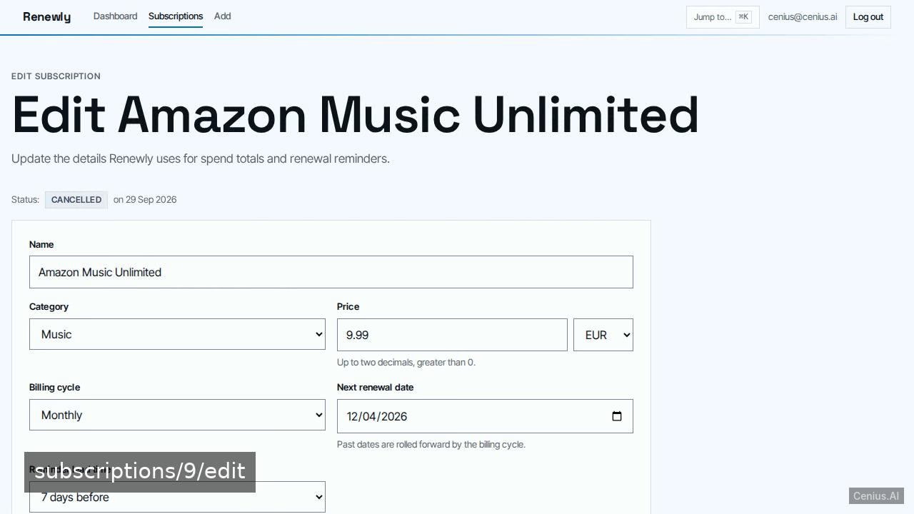
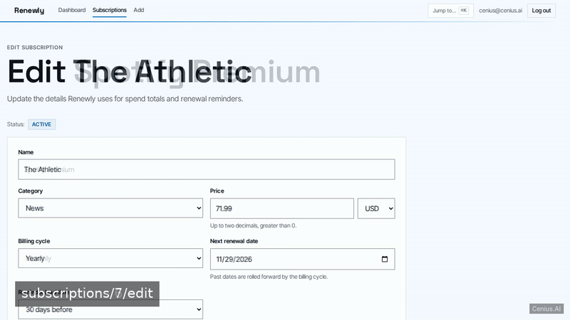
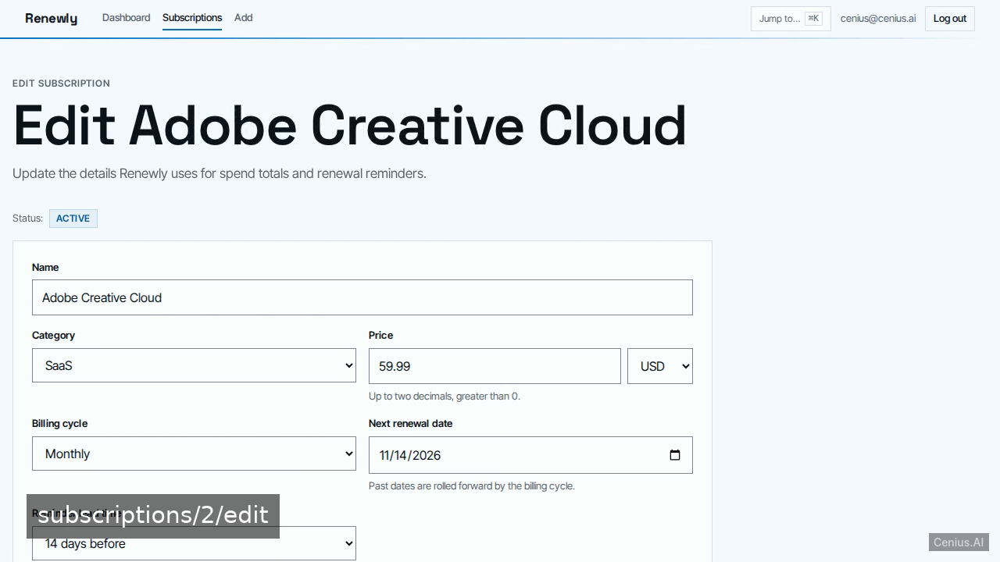
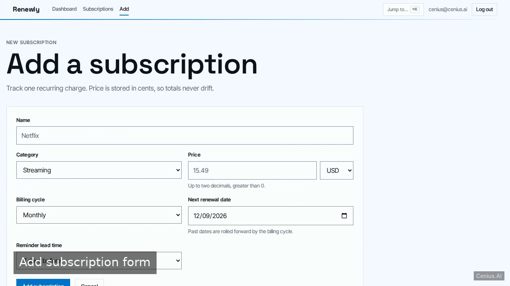
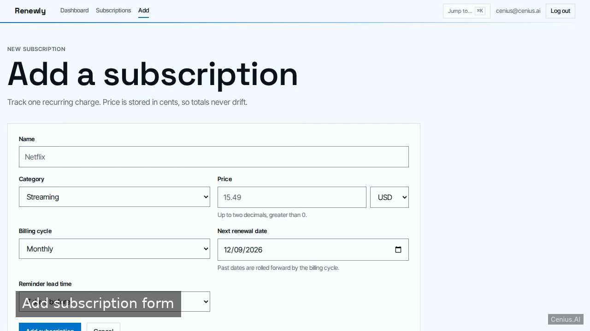

# Renewly Subscription Tracker — production-ready FastAPI personal finance tracker starter

Clone it. Run it. Own it. **Renewly Subscription Tracker** is a complete, Apache-2.0-licensed personal finance tracker in FastAPI — full source, demo data included. Renewly is a self-hosted subscription tracker for people auditing their streaming and SaaS spend, built as one FastAPI service: uvicorn serves server-rendered Jinja2 pages, SQLite holds users and subscriptions through…. Self-host Renewly Subscription Tracker on your own infrastructure, or open it on [cenius.ai](https://cenius.ai/marketplace/p/renewly-subscription-tracker?ref=gh&utm_campaign=renewly-subscription-tracker-fastapi) to request changes and get a Renewly Subscription Tracker fresh build.


[](LICENSE)  [](https://cenius.ai)

[](https://cenius.ai/marketplace/p/renewly-subscription-tracker?ref=gh&utm_campaign=renewly-subscription-tracker-fastapi)

> **▶ [Open & edit in cenius.ai](https://cenius.ai/marketplace/p/renewly-subscription-tracker?ref=gh&utm_campaign=renewly-subscription-tracker-fastapi)** — one click to an editable workspace: describe changes in plain English, get an instant preview, one-click deploy and host. Modifications made on the platform come with full rebrand & relicense rights.

_Local clone? See [Quick start](#quick-start) below. cenius.ai is the zero-setup path._

## Demo





▶ **[Video walkthrough](https://cenius.ai/marketplace/p/renewly-subscription-tracker?ref=gh&utm_campaign=renewly-subscription-tracker-fastapi)** — see the app in action on the cenius.ai project page · [MP4 file](.github/media/demo.mp4)

## Screenshots

  

## Usage guide

A short walkthrough of every screen, using the seeded demo account
`cenius@cenius.ai` / `cenius`.

### Sign in

`/login` is a two-column page: what Renewly does on the left, the sign-in card on the right.
The card shows the demo credentials and a **Fill demo credentials** button, a show/hide
toggle on the password field, and a link to create an account. A wrong password re-renders
the page with one generic message ("Email or password is incorrect.") and keeps your email.

`/signup` creates a local account. Email shape, an 8-character minimum and the confirm field
are all checked server-side; failures are shown inline and keep your email address.

### Dashboard (`/dashboard`)

- **This month / This year** — normalised spend, one line per currency in use, next to the
  active-subscription count.
- **Saved by cancelling** — the monthly and yearly cost of everything you cancelled, per
  currency, excluded from the totals above.
- **Upcoming renewals** — active subscriptions whose next charge falls inside their own
  reminder lead time and within 30 days, soonest first. Countdowns read "today", "in 3 days";
  rows whose stored date had already passed say "overdue date rolled forward".
- **Spend by category** — monthly and yearly columns per currency with a total row.

A brand-new account sees zeroed cards, an empty savings card and a prompt to add the first
subscription.

### Subscriptions (`/subscriptions`)

_Full guide: [`USAGE.md`](USAGE.md)_

## Features

- Email/password accounts with session login
- Subscription CRUD with billing cycle, price and currency
- Renewal reminders before the next charge
- Monthly and yearly spend totals by category
- Cancel and resume with a cancelled-savings tally
- Seed demo account so the app demos well immediately
- README for open-source self-hosting

## Quick start

```bash
./install.sh   # installs dependencies + seeds demo data
```

See [`INSTALL.md`](INSTALL.md) for full setup and usage instructions.

## Architecture

A self-contained FastAPI project (70 files): top-level directories include `app/`, `tests/`. `install.sh` takes care of packages and initial data in a single pass; nothing else is required before launching. Full setup details: [`INSTALL.md`](INSTALL.md).

## FAQ

### How do I get Renewly Subscription Tracker running locally?

Pull the repo, run `./install.sh`, and you are up — the script installs packages and pre-seeds the database. [`INSTALL.md`](INSTALL.md) covers any platform-specific tweaks.

### Can I rebrand or white-label Renewly Subscription Tracker?

White-labeling is supported: fork the MIT-licensed source and rebrand it yourself, or use [cenius.ai](https://cenius.ai/marketplace/p/renewly-subscription-tracker?ref=gh&utm_campaign=renewly-subscription-tracker-fastapi) to make changes in a guided workspace — platform modifications come with full rebrand rights.

### Can I build a business on Renewly Subscription Tracker?

Yes — Apache-2.0-licensed, so commercial use, modification, and distribution are all permitted. Read the full terms in [LICENSE](LICENSE).

### Which framework or language does Renewly Subscription Tracker use?

FastAPI. The full source in this repository is exactly what the app runs. Highlights include subscription CRUD with billing cycle, price and currency.

### Is Renewly Subscription Tracker editable without a developer?

Describe what you want changed on [cenius.ai](https://cenius.ai/marketplace/p/renewly-subscription-tracker?ref=gh&utm_campaign=renewly-subscription-tracker-fastapi) — no code editing needed; the platform produces a fresh build you can download and deploy.

## License & rebranding

Released under the [Apache License 2.0](LICENSE) (© 2026 Cenius AI) — free for personal and commercial use. The Cenius name/logo are trademarks (see NOTICE).

**Need a customized version?** [Remix this app on cenius.ai](https://cenius.ai/marketplace/p/renewly-subscription-tracker?ref=gh&utm_campaign=renewly-subscription-tracker-fastapi) — modifications made on the platform come with **full rebrand & relicense rights** over your derivative.

## Built with cenius.ai

This entire application — code, design, seeded demo data — was generated on **[cenius.ai](https://cenius.ai)** from a plain-English description.

- 🚀 [Build your own app on cenius.ai](https://cenius.ai)
- 🎛️ [Remix Renewly Subscription Tracker on the marketplace](https://cenius.ai/marketplace/p/renewly-subscription-tracker?ref=gh&utm_campaign=renewly-subscription-tracker-fastapi) — open it in a workspace, prompt for changes, and ship your own version.

More open-source apps: [the Cenius-ai catalog](https://github.com/Cenius-ai) · [showcase index](https://github.com/Cenius-ai/showcase)
